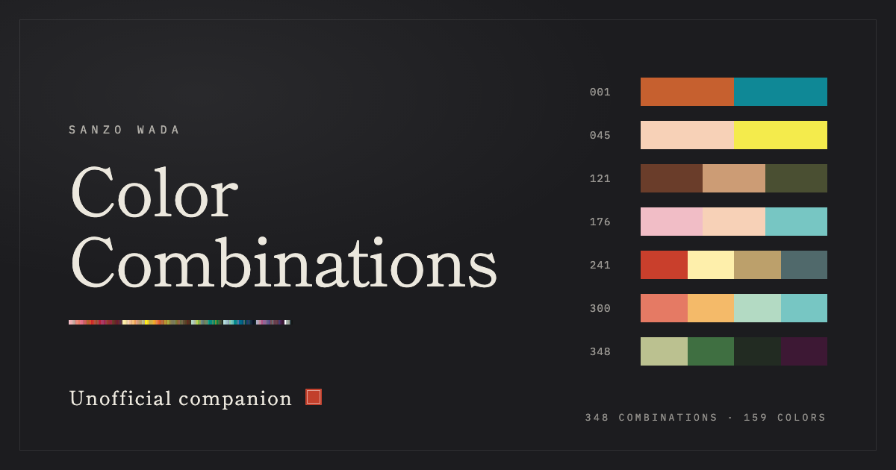

# Sanzo Wada Color Combinations

A free, unofficial companion to Sanzo Wada's *A Dictionary of Color Combinations*: all 348 combinations and 159 colors, read as a book you can page through on any screen.

**Read it:** https://subhranilmaity06.github.io/sanzo-wada-color-combinations/

## What's inside

- 348 combinations: 001–120 use two colors, 121–240 use three, 241–348 use four
- 159 colors, each with its CMYK print recipe and screen RGB and HEX values
- A color index grouped into six families, linking to every combination a color appears in

## Reading

- Drag a page to turn it, or use the arrow buttons, the arrow keys or the page edges
- Select any swatch to see its values and the combinations that use it, as color strips
- Jump to any combination by number (`/` focuses the number field)
- Link straight to a combination or a color, for example [`#c241`](https://subhranilmaity06.github.io/sanzo-wada-color-combinations/#c241) or [`#k12`](https://subhranilmaity06.github.io/sanzo-wada-color-combinations/#k12)
- Add it to your home screen to use it like an app; it works offline after the first visit

## About the data

The color list and every combination number were checked against the printed color index. Screen colors are converted from the CMYK recipes with a generic print profile, so they are close to the printed swatches but not identical. Use the CMYK values for print work. Within each combination, colors are listed in index order.

## The original book

The combinations come from Sanzo Wada's *Haishoku Soukan* (1933–34). The printed *A Dictionary of Color Combinations* is published by [Seigensha](https://www.seigensha.com/) (ISBN 978-4-86152-247-5). If these colors are useful to you, consider owning it or [finding it in a library](https://search.worldcat.org/search?q=bn%3A9784861522475).

## Rights and removal

This is an unofficial, non-commercial edition. It is not affiliated with Seigensha or with Sanzo Wada's estate, and it contains no scans or text from the printed book. If you hold rights to this material and want anything changed or removed, please [open an issue](https://github.com/Subhranilmaity06/sanzo-wada-color-combinations/issues).

## Made by

Designed and built by [Subhranil Maity](https://github.com/Subhranilmaity06). More on the [about page](https://subhranilmaity06.github.io/sanzo-wada-color-combinations/about.html).

Typefaces: Shippori Mincho, Zen Kaku Gothic New and IBM Plex Mono, all under the SIL Open Font License.
